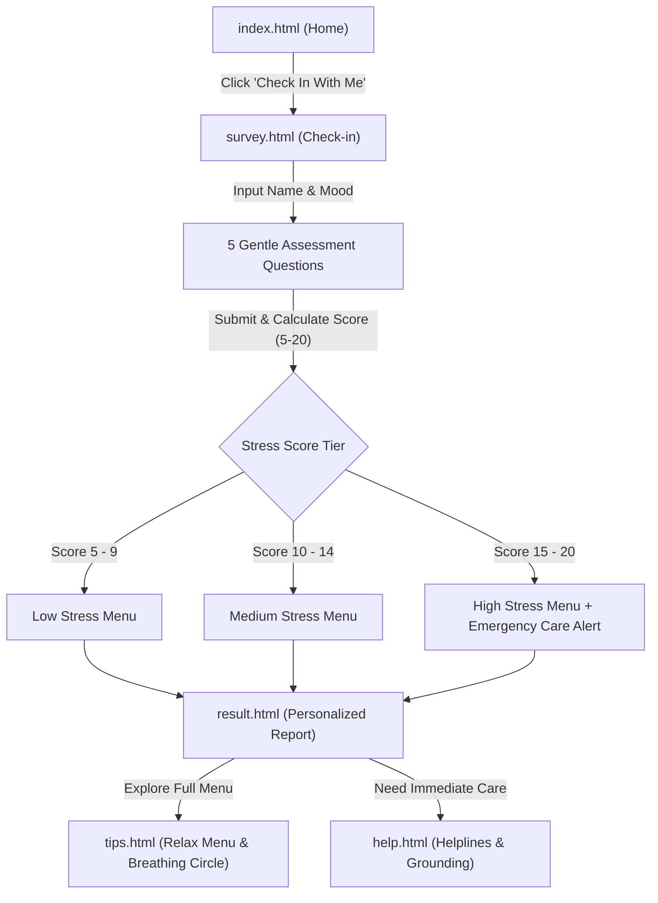

# ☕ MoodCafe — A Cozy Corner Where Your Mood Gets a Menu

[](https://developer.mozilla.org/en-US/docs/Web/HTML)
[](https://developer.mozilla.org/en-US/docs/Web/CSS)
[](https://developer.mozilla.org/en-US/docs/Web/JavaScript)
[](LICENSE)
[](https://siratpreetkaur18.github.io/MoodCafe/)
[](#)

> **Continuous Assessment (CA) Project for Web Development / HTML Coursework**  
> **Live Website:** [https://siratpreetkaur18.github.io/MoodCafe/](https://siratpreetkaur18.github.io/MoodCafe/)  
> **Developed by:** Siratpreet Kaur ([@siratpreetkaur18](https://github.com/siratpreetkaur18)), Anshal, and Swapna.

---

## 📖 Table of Contents
- [Project Overview](#-project-overview)
- [Problem Statement & Motivation](#-problem-statement--motivation)
- [Core Features](#-core-features)
- [Website Structure & Pages](#-website-structure--pages)
- [Architecture & User Journey](#-architecture--user-journey)
- [Tech Stack](#-tech-stack)
- [Directory Layout](#-directory-layout)
- [How to Run Locally](#-how-to-run-locally)
- [Coursework & CA Evaluation Alignment](#-coursework--ca-evaluation-alignment)
- [Future Roadmap](#-future-roadmap)
- [Authors & Credits](#-authors--credits)
- [License](#-license)

---

## 🌟 Project Overview

**MoodCafe** is a warm, student-focused mental wellness web application designed to normalize daily emotional check-ins. Just as you step into a cozy café to order a beverage suited to your craving, **MoodCafe** lets users check in with their current emotional state and receive a personalized **"Relax Menu"** of evidence-backed self-care activities:
- 🧘 **Meditation & Grounding**
- 🏃 **Gentle Physical Exercise**
- 🎵 **Mood-Lifting & Ambient Music**
- 🍎 **Wholesome Nutrition & Hydration**
- 🌬️ **Guided 1-Minute Visual Breathing Circle**

---

## 🎯 Problem Statement & Motivation

### The Challenge
Students experience intense pressure from examinations, assignments, family expectations, finances, and career uncertainty. Despite these pressures:
1. **Unnoticed Stress:** Moods fluctuate throughout the day, but emotional fatigue often goes ignored until it compounds into severe anxiety or burnout.
2. **Clinical Hesitation:** Traditional mental health platforms often feel overly clinical, intimidating, or clinical-diagnostic.
3. **Inertia:** When stressed or overwhelmed, individuals rarely know what small, accessible first step to take.

### Our Solution
MoodCafe was built around a comforting premise: **"Noticing how we feel is the first step."**  
We wanted the initial step to feel as warm, inviting, and approachable as ordering your favorite warm drink. MoodCafe requires no sign-ups, runs 100% locally in the user's browser, and ensures total privacy.

---

## 🚀 Core Features

- 💬 **Gentle Mood Check-in:** Select from 6 intuitive mood cards (Happy, Calm, Tired, Sad, Worried, Angry) and answer 5 non-intrusive psychometric assessment questions.
- 📊 **Dynamic Stress Score Calculation:** Computes a composite stress indicator scored from 5 to 20:
  - 🟢 **Low Stress (5–9):** Encouragement and gentle maintenance practices.
  - 🟠 **Medium Stress (10–14):** Focused breathing, active walks, and balanced downtime.
  - 🔴 **High Stress (15–20):** Dedicated high-care protocol, 5-4-3-2-1 sensory grounding, and immediate emergency helplines.
- 🍽️ **Tailored Relax Menu:** Serves custom recommendations dynamically generated to match the user's specific mood, score tier, and life situation (studies, career, relationships, finances).
- 🌬️ **Interactive Breathing Circle:** A synchronized CSS-animated breathing visualizer guiding users through a 4s inhale, 4s hold, and 6s exhale cycle.
- 🤝 **Comprehensive Support Directory:** Emergency helplines (Tele-MANAS `14416`, KIRAN `1800-599-0019`, emergency `112`) and calming grounding techniques.
- 💭 **Thought of the Day Generator:** Interactive rotating repository of uplifting quotes on the homepage.
- 🔒 **100% Private & Client-Side:** No cookies, no external tracking, no backend database. Assessment state persists safely in browser `localStorage`.
- 📱 **Fully Responsive:** Custom CSS media queries, adaptive hamburger drawer menu, and mobile-friendly tap targets.

---

## 📄 Website Structure & Pages

| Page | File | Purpose |
| :--- | :--- | :--- |
| **Home** | [`index.html`](index.html) | Warm welcoming hero section, interactive animated bubbles, project overview, quote generator, and quick facts. |
| **Mood Check** | [`survey.html`](survey.html) | 5 gentle assessment questions, primary worry dropdown, and mood selector with instant validation. |
| **Result Report** | [`result.html`](result.html) | Personalized stress score badge (Low / Medium / High), tailored advice, and custom Relax Menu items. |
| **Relax Menu** | [`tips.html`](tips.html) | Deep-dive relaxation categories with anchor navigation and the animated 1-minute breathing circle. |
| **Need Help?** | [`help.html`](help.html) | Tele-MANAS (14416), KIRAN (1800-599-0019), emergency 112 guidance, and 5-4-3-2-1 grounding exercises. |

---

## 📐 Architecture & User Journey



---

## 🛠️ Tech Stack

- **HTML5:** Semantic document outline (`<header>`, `<nav>`, `<main>`, `<section>`, `<article>`, `<footer>`, form controls).
- **CSS3:** Custom gradient palettes, Flexbox and CSS Grid layouts, `@keyframes` animations (`fadeUp`, `float`, `breathe`), sticky navbar, responsive media queries.
- **JavaScript (Vanilla ES6):** Event-driven logic, DOM manipulation, form validation, dynamic HTML generation, and browser `localStorage` integration.
- **Google Fonts:** Poppins (weights 400 and 600) for clean modern readability.
- **Asset Formats:** Transparent PNG brand marks and favicon.

---

## 📁 Directory Layout

```text
moodcafe/
├── css/
│   └── style.css               # Unified responsive stylesheet and animations
├── docs/
│   └── MoodCafe_Presentation.pptx # CA presentation slide deck
├── images/
│   ├── favicon.png             # MoodCafe browser tab icon
│   ├── logo-icon.png           # Navigation and footer brand emblem
│   └── logo.png                # High-resolution hero display logo
├── js/
│   ├── home.js                 # Thought for today interactive quote rotator
│   ├── result.js               # Stress scoring engine and dynamic menu builder
│   └── survey.js               # Check-in validation and localStorage coordinator
├── .gitignore                  # Standard version control exclusion rules
├── help.html                   # Helplines, mental health resources & grounding
├── index.html                  # Landing page and platform introduction
├── LICENSE                     # MIT Open Source License
├── README.md                   # Comprehensive project documentation
├── result.html                 # Personalized stress analysis and advice
├── survey.html                 # 5-question mood and wellness assessment
└── tips.html                   # Complete relax menu & 1-minute breathing circle
```

---

## 💻 How to Run Locally

Because MoodCafe is built with pure web technologies and zero server dependencies, getting started is instant:

### Option 1: Direct File Opening
1. Clone or download this repository:
   ```bash
   git clone https://github.com/siratpreetkaur18/MoodCafe.git
   ```
2. Navigate to the project directory:
   ```bash
   cd MoodCafe
   ```
3. Double-click `index.html` or open it in any web browser (Chrome, Edge, Firefox, Safari).

### Option 2: Using VS Code Live Server
1. Open the project folder in **Visual Studio Code**.
2. Install the **Live Server** extension (by Ritwick Dey).
3. Right-click `index.html` and select **"Open with Live Server"**.

---

## 🎓 Coursework & CA Evaluation Alignment

This project was built to satisfy all criteria for college Continuous Assessment (CA):
- [x] **Semantic HTML Structure:** Valid doctype, `<html lang="en">`, `<head>` meta tags (`charset`, `viewport`, `description`), header, navigation, main sections, and semantic footer.
- [x] **Clean Form Controls:** Comprehensive dropdowns, inputs, placeholder text, clear labeling, and validation before submission.
- [x] **Custom CSS Styling:** Advanced multi-stop linear gradients, smooth drop shadows, hover transitions, and sticky navigation.
- [x] **CSS Animations:** Keyframe-based breathing circle, floating bubble backdrop, and fade-up view entry.
- [x] **Responsive Design:** Fluid layout adapting smoothly from 4K desktop screens down to smartphones (<700px) with a functional hamburger drawer menu.
- [x] **Client-Side State Persistence:** Utilizes HTML5 `localStorage` to pass user answers and computed results seamlessly between pages without a server.
- [x] **Accessibility & Code Quality:** Proper alt text on images, clean indentation, well-commented code, and high contrast colors.

---

## 🔮 Future Roadmap

- [ ] **Mood Journal:** Add calendar history tracking so students can review their emotional journey across weeks or exam seasons.
- [ ] **Built-in Audio Player:** Integrated soothing ambient soundscapes (rain, forest, lo-fi beats) directly playable inside `tips.html`.
- [ ] **Dark / Night Mode:** Warm low-light theme for late-night study sessions.
- [ ] **Daily Streak Tracker:** Motivate daily mindful check-in habits with gentle gamification.

---

## 👥 Authors & Credits

**MoodCafe** was created with care as an academic project by:
- **Siratpreet Kaur** — Lead Developer & Concept Design ([@siratpreetkaur18](https://github.com/siratpreetkaur18))
- **Anshal** — Research, Content Design & Presentation
- **Swapna** — UI Layout, Color Palette & Testing

*Course: HTML, CSS & JavaScript Continuous Assessment (CA)*

---

## 📜 License

This project is licensed under the [MIT License](LICENSE) — free for educational and personal use.
